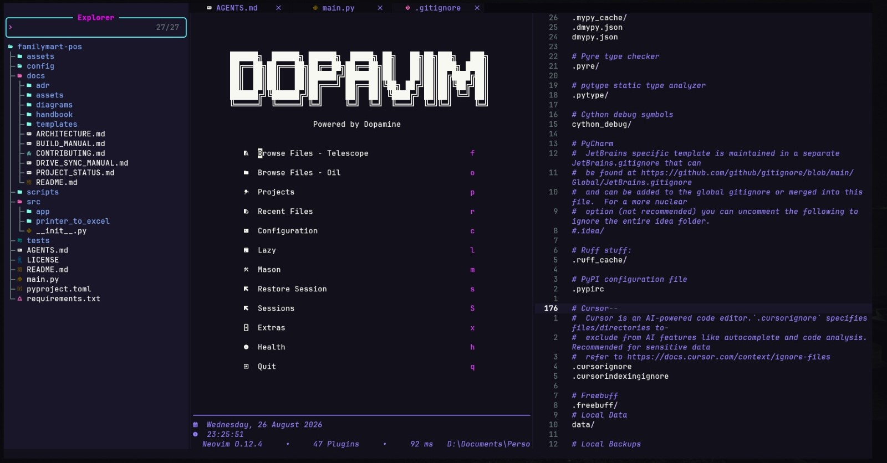

# 🧠 DopaVim

> **A Neovim distribution for people who actually
> love coding and are IN for the love of the game.**\
> *Built on LazyVim. Personalized from the ground up. Fueled by
> Dopamine.*

[](https://neovim.io/)
[](https://www.lazyvim.org/)
[](https://github.com/musaeed178-uio/nvim-config)
[](https://github.com/musaeed178-uio/nvim-config/blob/main/LICENSE)

```
  ██████╗  ██████╗ ██████╗  █████╗ ██╗   ██╗██╗███╗   ███╗
  ██╔══██╗██╔═══██╗██╔══██╗██╔══██╗██║   ██║██║████╗ ████║
  ██║  ██║██║   ██║██████╔╝███████║██║   ██║██║██╔████╔██║
  ██║  ██║██║   ██║██╔═══╝ ██╔══██║╚██╗ ██╔╝██║██║╚██╔╝██║
  ██████╔╝╚██████╔╝██║     ██║  ██║ ╚████╔╝ ██║██║ ╚═╝ ██║
  ╚═════╝  ╚═════╝ ╚═╝     ╚═╝  ╚═╝  ╚═══╝  ╚═╝╚═╝     ╚═╝
                   Powered by Dopamine
```

------------------------------------------------------------------------



## 📖 What is DopaVim?

**DopaVim** is my personal Neovim environment, built on top of
**LazyVim** and shaped through a lot of experimentation, debugging,
rebuilding, and customization.

The goal was never to create another "minimal Neovim config."

The goal was to build an editor that feels **mine** and saves the frustration frustration
of customizing other's distros according to your own preferences and workflow.

DopaVim combines:

-   a solid LazyVim foundation (that means LSP and treesitter right out of the box)
-   multiple dark aesthetic themes
-   fast navigation (Telescope + Oil) and fuzzy finding
-   floating terminals on `Alt+i` / `Alt+c` / `Alt+b` (PowerShell, default
    shell, Git Bash - each one resolved for the OS you are on)
-   a practical file-management workflow
-   custom dashboard and session workflows
-   project management with project.nvim
-   theme persistence across sessions
-   carefully chosen plugins (except for themes, they come without any reason
    cause of course, it's DopaVim. To enable/add more themes, just uncomment already
    existing themes inside plugins/theme.lua or add a new theme there yourself.)
-   personalized keymaps
-   a setup optimized for an actual day-to-day development

I use Neovim as more than a text editor. It is the place where I work on
university projects, programming experiments, AI/ML learning,
system-level experiments, and larger personal projects.

So DopaVim is intentionally opinionated.

It is not designed to satisfy everyone. (It will, in-case it grows.)
(Or you can contact me if it doesn't)

**It is designed to make me (and Ideally, you) want to open Neovim.**

------------------------------------------------------------------------

## ⚡ Philosophy

DopaVim follows a few simple principles:

### 1. Build on a strong foundation

There is no reason to reinvent everything.

LazyVim already solves a huge amount of the difficult infrastructure:
plugin management, sensible defaults, LSP integration, completion,
Treesitter, Git tooling, and much more.

DopaVim builds **on top of that foundation** instead of replacing it.

### 2. Customize what actually matters

Not every option needs to be changed.

The configuration focuses on things that affect everyday interaction:

-   navigation
-   terminals
-   files
-   dashboards
-   sessions
-   appearance
-   keymaps
-   workflow shortcuts

### 3. Function first, aesthetics second

The cyberpunk aesthetic is important because the editor should be
enjoyable to look at.

But aesthetics never replace usability.

Every customization has to earn its place.

### 4. Keep the workflow fast

The ideal workflow is:

> **think → type → navigate → run → inspect → repeat**

The editor should stay out of the way.

------------------------------------------------------------------------

# ✨ Features

## 🚀 LazyVim Foundation

DopaVim uses **LazyVim** as its core.

This provides a mature base for:

-   lazy-loaded plugins
-   LSP
-   Treesitter
-   completion
-   formatting
-   Git integration
-   Telescope
-   diagnostics
-   sensible defaults
-   plugin management

The custom configuration only overrides or extends what I actually want
to change.

------------------------------------------------------------------------

## 🎨 Themes

DopaVim comes with several dark, cyberpunk-inspired colorschemes
pre-installed and ready to use:

-   **SilkCircuit** (default) — a vibrant cyberpunk theme with five
    intensity variants (neon, vibrant, soft, glow, dawn)
-   **Neofusion** — a rich, gradient-based dark theme
-   **Vulpes** — a warm, fox-inspired palette
-   **Rose-pine**, **Tokyodark**, **Gore**, **Plum**, **Farout**,
    **Eldritch**, **Night Owl**, **Boo**, **Poimandres**, **Moonfly**,
    **Gruvbox**, **One Dark**
-   plus LazyVim's own built-ins (Tokyonight, Catppuccin, …)

To add another one, uncomment/add a spec in `lua/plugins/theme.lua`.

Switching themes is built into LazyVim. Open the colorscheme picker with:

``` text
<leader> + u + C
```

This opens the **LazyVim Colorscheme** selector, where you can browse
and preview all available themes in real time.

**Theme persistence** is enabled by default. Your last chosen theme is
automatically saved and restored on the next startup — no need to
re-select it every time.

The visual direction across all themes is intentionally dark, vibrant,
and slightly futuristic — inspired by Blade Runner, cyberpunk
interfaces, terminal environments, neon-lit cityscapes, and dark
developer tooling.

------------------------------------------------------------------------

## 🖥️ Floating Terminals

DopaVim provides quick floating terminal access with three independent
sessions. The shell behind each key is resolved at runtime by
`lua/custom/shells.lua`, so the same keymap means the same *thing* on
Windows and on Linux.

| Key   | Slot            | Windows                       | Linux                                  |
| ----- | --------------- | ----------------------------- | -------------------------------------- |
| `Alt+i` | PowerShell    | `pwsh.exe`, else `powershell.exe` | `pwsh`, **warns and falls back** to `$SHELL` if missing |
| `Alt+c` | Default shell | `cmd.exe`                     | `$SHELL` (falls back to `/bin/sh`)     |
| `Alt+b` | Git Bash       | Git for Windows install paths | `bash`                                 |

Notes:

-   The Git Bash slot never accepts the WSL stub in `System32` (or the
    WindowsApps alias) as "Git Bash".
-   If a slot cannot find its preferred shell you get a notification and a
    working fallback instead of a dead window.
-   Every terminal `cd`s to the current buffer's directory. `cmd.exe` uses
    `cd /d` so changing drives works; POSIX shells get a plain `cd` with the
    correct line ending.
-   `Esc` leaves terminal mode; the slot's own `Alt+?` key re-toggles it.

------------------------------------------------------------------------

## 📂 Oil.nvim

**Oil.nvim** provides the file-management workflow.

The parent directory can be opened directly with:

``` text
-
```

Oil is used instead of relying exclusively on a traditional tree-based
file explorer.

This keeps filesystem operations closer to the actual editing workflow.

------------------------------------------------------------------------

## 🔍 Telescope

Telescope is used throughout DopaVim for fast fuzzy searching.

It provides quick access to things such as:

-   files
-   buffers
-   recent files
-   live grep
-   Git information
-   plugins
-   sessions
-   projects
-   project content

The intention is simple:

> **If I know roughly what I'm looking for, I shouldn't have to manually
> navigate to it.**

------------------------------------------------------------------------

## 📁 Projects

DopaVim integrates **project.nvim** for tracking recent project
directories.

Projects are accessible from:

-   the **dashboard** (Projects button)
-   **Telescope** via the projects extension

To register a project, open any project folder and run `:ProjectRoot`.
That directory will appear in the projects picker for quick access in
future sessions.

------------------------------------------------------------------------

## 💾 Session Management

DopaVim makes project/session restoration part of the dashboard
workflow.

The dashboard provides quick access to:

-   restoring the previous session
-   selecting from saved sessions
-   starting a fresh editing environment

This is particularly useful when switching between multiple university
and personal projects.

------------------------------------------------------------------------

## ⚡ Blink.cmp

DopaVim uses **Blink.cmp** for completion.

The goal is fast, unobtrusive completion without turning the editor into
a giant autocomplete interface.

------------------------------------------------------------------------

## 🧠 Lazy Extras

LazyVim's extras system is retained.

This means additional functionality can be enabled when needed without
permanently bloating the core configuration.

The philosophy is:

> **Use what is useful. Disable what isn't.**

Seventeen extras are enabled right now:

-   **coding** - `yanky`
-   **editor** - `telescope`
-   **lang** - `dart`, `dotnet`, `git`, `java`, `json`, `markdown`, `php`,
    `python`, `sql`, `typescript`
-   **ui** - `alpha`, `smear-cursor`
-   **util** - `project`, `startuptime`
-   **vscode** - `vscode`

The live list lives in `lazyvim.json`, which is tracked, so a fresh clone
gets the same seventeen. Add or drop one with `:LazyExtras`.

------------------------------------------------------------------------

## 🛠️ Custom Keymaps

The default keymaps are extended with mappings designed around my own
workflow.

Examples include shortcuts for:

-   file navigation
-   dashboard toggle (`<leader>h`)
-   terminal access (`Alt+i`, `Alt+c`, `Alt+b` — shells resolved per-OS)
-   buffer navigation (`<leader>1-9`)
-   splits (`<leader>sv`, `<leader>sh`)
-   projects (`<leader>fp`) and plugin files (`<leader>fP`)
-   searching
-   deleting without polluting the yank register
-   common editor actions

The configuration intentionally favors muscle memory and short command
sequences over memorizing long command names.

------------------------------------------------------------------------

## 🏠 Custom Dashboard

The dashboard is one of the most visible parts of DopaVim.

It acts as the editor's starting point rather than simply displaying an
empty buffer.

The dashboard features:

-   a custom **block-character ASCII logo** with per-line gradient
    highlighting (pink → purple → blue)
-   a **live clock** that updates every second
-   CWD display showing the current working directory
-   Neovim version, plugin count, and startup time

**Dashboard buttons:**

| Key | Action                       |
| --- | ---------------------------- |
| `f` | Browse Files (Telescope)     |
| `o` | Browse Files (Oil)           |
| `p` | Projects (project.nvim)      |
| `r` | Recent Files                 |
| `c` | Configuration (Oil)          |
| `l` | Lazy (plugin manager)        |
| `m` | Mason (LSP installer)        |
| `s` | Restore Session              |
| `S` | Sessions picker              |
| `x` | LazyVim Extras               |
| `h` | Health check                 |
| `q` | Quit                         |

The dashboard is meant to feel like a **control panel for the editor**.

------------------------------------------------------------------------

# 🧰 Tech Stack

DopaVim currently revolves around:

  Component            Role
  -------------------- -----------------------------
  **Neovim**           Editor
  **LazyVim**          Base distribution
  **lazy.nvim**        Plugin manager
  **SilkCircuit**      Colorscheme (default, 5 variants)
  **Blink.cmp**        Completion
  **Telescope**        Fuzzy finding
  **Oil.nvim**         File management
  **project.nvim**     Project management
  **alpha-nvim**       Dashboard
  **Treesitter**       Syntax parsing/highlighting
  **LSP**              Language intelligence
  **Conform.nvim**     Formatting
  **Git tooling**      Version-control workflow

The exact plugin set can evolve as the configuration evolves.

------------------------------------------------------------------------

# 🗂️ Configuration Structure

The configuration follows LazyVim's modular structure.

``` text
nvim/
├── init.lua
├── lazy-lock.json              # pinned plugin commits  (TRACKED — do not ignore)
├── lazyvim.json                # LazyVim extras          (TRACKED — do not ignore)
├── stylua.toml
├── .gitattributes
├── .neoconf.json
│
├── lua/
│   ├── config/
│   │   ├── autocmds.lua
│   │   ├── keymaps.lua
│   │   ├── lazy.lua
│   │   └── options.lua
│   │
│   ├── custom/
│   │   ├── shells.lua              # per-OS shell resolution
│   │   ├── floating_term.lua       # shared floating terminal engine
│   │   ├── terminal.lua            # Alt+i  PowerShell slot
│   │   ├── cmd_terminal.lua        # Alt+c  default-shell slot
│   │   ├── gitbash_terminal.lua    # Alt+b  Git Bash slot
│   │   └── theme_persistence.lua   # Save/restore last theme
│   │
│   ├── dopavim/
│   │   └── health.lua              # :checkhealth dopavim
│   │
│   └── plugins/
│       ├── browse-telescope.lua
│       ├── dashboard.lua
│       ├── lint.lua
│       ├── lsp.lua
│       ├── nvim-docx.lua
│       ├── oil.lua
│       ├── pdfview.lua
│       ├── project.lua             # project.nvim integration
│       ├── theme.lua
│       └── treesitter.lua
│
├── scripts/
│   ├── install.ps1                 # Windows installer
│   └── install.sh                  # Linux/macOS installer
│
├── images/
└── README.md
```

Two files in that tree are what make a clone reproduce your setup, and
both are deliberately **tracked**:

-   `lazyvim.json` — the enabled LazyVim extras (languages, dashboard,
    Telescope, yanky, …). Without it a fresh clone silently loses most of
    the distribution.
-   `lazy-lock.json` — the exact commit of every plugin. Without it a fresh
    clone installs whatever `HEAD` happens to be that day.

If you run `:Lazy sync` or toggle anything in `:LazyExtras`, commit the
resulting changes.

The important distinction is that DopaVim does **not** replace LazyVim's
architecture.

It extends it.

That makes the configuration easier to maintain while still allowing
extensive personalization.

------------------------------------------------------------------------

# ⌨️ Workflow

DopaVim is built around a keyboard-first workflow.

The general interaction model is:

``` text
Dashboard
   │
   ├── Browse Files ──────> Telescope / Oil
   ├── Projects ──────────> project.nvim
   ├── Recent files ──────> Telescope
   ├── Sessions ──────────> Session manager
   ├── Terminal ──────────> PowerShell / default shell / Git Bash
   └── Configuration ─────> Neovim config
```

The objective is to minimize context switching between:

-   editor
-   file manager
-   terminal
-   project search
-   Git
-   configuration

Everything should be reachable from the keyboard.

------------------------------------------------------------------------

# 📦 Installation

## Platform support

| Platform | Status | Notes |
| --- | --- | --- |
| **Windows 10/11** | Tested | The development platform. Every change is exercised here, on Neovim 0.12.4. |
| **Linux** | Designed for, **untested** | Per-OS shell resolution, `install.sh` and `:checkhealth dopavim` are all written for it - but it has never actually been run. |
| **macOS** | Untested | Nothing in the config is Windows-only, and nothing is known to be Linux-only, so it should work. Nobody has tried. |

## Prerequisites

DopaVim is a LazyVim distribution, and `nvim-treesitter` runs on its
`main` branch, so the bar is a little higher than a stock Neovim setup.

| Requirement | Why | Windows | Linux |
| --- | --- | --- | --- |
| **Neovim ≥ 0.12.0** | `nvim-treesitter` main-branch hard requirement | `winget install Neovim.Neovim` | distro package / [bob](https://github.com/MordechaiHadad/bob) |
| **Git ≥ 2.19** | lazy.nvim partial clones | `winget install Git.Git` | `apt/dnf/pacman install git` |
| **ripgrep (`rg`)** | live grep in the picker | `scoop install ripgrep` | `apt install ripgrep` |
| **C compiler** | treesitter compiles parsers | MSYS2/MinGW, LLVM or VS Build Tools | `build-essential` / `base-devel` |
| **tree-sitter-cli ≥ 0.26.1** | treesitter installs parsers — use a package manager, **not npm** | `scoop install tree-sitter` | `pacman -S tree-sitter`, `apt install tree-sitter-cli` |
| **`tar` + `curl`** | treesitter downloads | both ship with Windows 10+ | preinstalled |
| **Nerd Font** | icons everywhere | e.g. JetBrains Mono Nerd Font | same |
| `fd` *(recommended)* | faster file finding | `scoop install fd` | `apt install fd-find` |
| `pwsh` *(optional)* | the `Alt+i` slot on Linux | built in on Windows 10/11 | `apt install powershell` |
| `pandoc` *(optional)* | `.docx` editing (`nvim-docx`) | `winget install JohnMacFarlane.Pandoc` | `apt install pandoc` |
| `pdftotext` *(optional)* | `PDFview` text extraction | `scoop install poppler` | `apt install poppler-utils` |
| `node` *(optional)* | `markdown-preview.nvim` | `winget install OpenJS.NodeJS.LTS` | `apt install nodejs` |

You do not have to guess. After installing, run:

``` vim
:checkhealth dopavim
```

It probes every item above **on that machine** and prints an
`ERROR`/`WARNING` for anything that is missing, with the install command
for your OS.

------------------------------------------------------------------------

## Quick install

### Windows (PowerShell)

``` powershell
git clone https://github.com/musaeed178-uio/nvim-config.git "$env:LOCALAPPDATA\nvim"
nvim
```

Or use the installer script, which backs up anything already in
`%LOCALAPPDATA%\nvim` and restores the pinned plugins:

``` powershell
git clone https://github.com/musaeed178-uio/nvim-config.git "$env:TEMP\dopavim"
powershell -ExecutionPolicy Bypass -File "$env:TEMP\dopavim\scripts\install.ps1"
```

### Linux / macOS

``` bash
git clone https://github.com/musaeed178-uio/nvim-config.git "${XDG_CONFIG_HOME:-$HOME/.config}/nvim"
nvim
```

Or the installer script:

``` bash
git clone https://github.com/musaeed178-uio/nvim-config.git /tmp/dopavim
/tmp/dopavim/scripts/install.sh
```

> If you use `NVIM_APPNAME` to keep multiple configurations, clone to
> `${XDG_CONFIG_HOME:-$HOME/.config}/$NVIM_APPNAME` instead.

------------------------------------------------------------------------

## What happens on first launch

1.  `lua/config/lazy.lua` bootstraps lazy.nvim into `stdpath("data")/lazy`.
2.  lazy.nvim installs the **exact commits** listed in `lazy-lock.json`.
3.  LazyVim imports the **extras** listed in `lazyvim.json`
    (languages, Telescope, alpha dashboard, yanky, …).
4.  Treesitter compiles the parsers declared in `lua/plugins/treesitter.lua`.
5.  `lua/plugins/theme.lua` paints the default theme and then restores your
    persisted one, if any.

If step 2 or 4 fails it is almost always a missing prerequisite — see
`:checkhealth dopavim`.

------------------------------------------------------------------------

## Keeping it reproducible

`lazy-lock.json` and `lazyvim.json` are the two files that make a clone
reproduce your setup. **Both are tracked and must never be
re-added to `.gitignore`.**

After changing plugins or extras:

``` vim
:Lazy sync
```

`:Lazy sync` installs what is missing, removes what is gone and **updates
every plugin to the tip of its branch**, rewriting `lazy-lock.json` with the
new pins. That is correct when you have deliberately changed a spec - but it
moves you *forward*, it does not reproduce what you already had.

To snap back to the pinned state instead:

``` vim
:Lazy restore
```

`restore` checks out exactly the commits in `lazy-lock.json` and leaves the
file untouched. `sync` changes the pins; `restore` obeys them. Use
`restore` to reproduce, `sync` to evolve.

Then commit the diff (only when the change was intentional):

``` powershell
git add lazy-lock.json lazyvim.json
git commit -m "Update plugin pins/extras"
```

## Upgrading

``` powershell
git -C "$env:LOCALAPPDATA\nvim" pull
```

``` bash
git -C "${XDG_CONFIG_HOME:-$HOME/.config}/nvim" pull
```

Then, inside Neovim:

-   `:Lazy restore` — snap to the newly committed pins (reproducible).
-   `:Lazy update` — move everything forward (then commit the new pins).

------------------------------------------------------------------------

# ⚙️ Customization

DopaVim is meant to be customized.

### Keymaps

Edit:

``` text
lua/config/keymaps.lua
```

This is where personal keyboard behavior lives.

### Options

Edit:

``` text
lua/config/options.lua
```

Use this for editor-level options and behavior.

### Plugins

Add or override plugins inside:

``` text
lua/plugins/
```

LazyVim's plugin-spec architecture makes it possible to modify existing
plugins without rewriting their entire configuration.

### Custom Modules

The `lua/custom/` directory contains hand-built modules:

-   `shells.lua` — per-OS shell resolution + `cd`/line-ending handling
-   `floating_term.lua` — the shared floating terminal engine (window
    geometry, cwd tracking, lifecycle, terminal-mode keymaps)
-   `terminal.lua` — `Alt+i` PowerShell slot
-   `cmd_terminal.lua` — `Alt+c` default-shell slot
-   `gitbash_terminal.lua` — `Alt+b` Git Bash slot
-   `theme_persistence.lua` — saves and restores the last used colorscheme
    across sessions

`lua/dopavim/health.lua` powers `:checkhealth dopavim`.

### Dashboard

Dashboard behavior and appearance can be modified through the relevant
plugin configuration under:

``` text
lua/plugins/dashboard.lua
```

### Terminal configuration

Terminal behavior lives in:

``` text
lua/custom/shells.lua             -- which shell each slot resolves to
lua/custom/floating_term.lua      -- window, cwd and lifecycle behavior
lua/custom/*_terminal.lua         -- per-slot geometry/timing tweaks
```

Adding a new slot means adding a resolver entry in `shells.lua` and a
three-line wrapper module.

### Health check

``` text
lua/dopavim/health.lua
```

Registers `:checkhealth dopavim`. If you introduce a new external
dependency for a plugin, add a probe there so other people cloning the
repo find out about it automatically.

The exact implementation may evolve as the configuration changes.

------------------------------------------------------------------------

# 🧪 Development Philosophy

DopaVim is not intended to be a frozen configuration.

It is a living environment.

New plugins may be added.

Old plugins may be removed.

Keymaps may change.

Themes may change.

Parts of the configuration may be rewritten when a better approach is
found.

The important thing is that the configuration remains understandable and
useful.

This is also a learning project.

Working on DopaVim has been a practical way to understand:

-   Lua
-   Neovim's architecture
-   plugin specifications
-   lazy loading
-   LSP
-   Treesitter
-   terminal integration
-   keymap systems
-   Git workflows
-   editor automation

Rather than treating Neovim as a black box, the goal is to gradually
understand the machinery underneath it.

------------------------------------------------------------------------

# 🧠 Why "DopaVim"?

The name comes from the idea behind the entire setup:

> **The editor should make you want to use it.**

Good tooling creates a feedback loop.

A command feels satisfying.

Navigation is immediate.

The interface looks good.

The terminal is one shortcut away.

A file appears exactly when expected.

A project opens exactly where it was left.

Small improvements compound.

That feeling is the point.

Hence:

**DopaVim.**

------------------------------------------------------------------------

# 🎬 Inspiration

The visual identity is heavily influenced by the atmosphere of **Blade
Runner** and cyberpunk computing:

-   dark environments
-   neon accents
-   terminal interfaces
-   futuristic workstations
-   dense information displays
-   minimal but deliberate visual noise

The aim isn't to reproduce a movie interface literally.

It is to capture the feeling of sitting in a futuristic workstation and
actually getting work done.

------------------------------------------------------------------------

# 🧑‍💻 About the Author

**Muhammad Umar Saeed**

Computer Science student and developer interested in:

-   software engineering
-   AI engineering
-   Python
-   C++
-   Java
-   databases
-   MongoDB and NoSQL systems
-   systems programming
-   Linux and Windows tooling
-   Neovim
-   developer tooling
-   automation
-   open-source software
-   literally anything, just name it

Projects and experiments range from university software systems to AI/ML
learning projects, POS/inventory systems, routing simulations, and
system-level experimentation. (Just AI thoughts btw)

DopaVim is one of those projects where the tooling itself becomes part
of the learning process. (and where just the tool to write code starts
giving you nightmares.)

------------------------------------------------------------------------

# 🙏 Credits

DopaVim stands on the work of many open-source developers.

Special thanks to:

-   [**LazyVim**](https://github.com/LazyVim/LazyVim) --- the foundation
    of the configuration.
-   [**Neovim**](https://github.com/neovim/neovim) --- the editor that
    makes this entire ecosystem possible.
-   [**SilkCircuit**](https://github.com/hyperb1iss/silkcircuit) ---
    the default colorscheme with multiple variants.
-   [**Neofusion**](https://github.com/diegoulloao/neofusion.nvim) ---
    an alternative colorscheme.
-   [**Oil.nvim**](https://github.com/stevearc/oil.nvim) --- filesystem
    editing.
-   [**Telescope.nvim**](https://github.com/nvim-telescope/telescope.nvim)
    --- fuzzy finding.
-   [**project.nvim**](https://github.com/ahmedkhalf/project.nvim) ---
    project management.
-   [**alpha-nvim**](https://github.com/goolord/alpha-nvim) ---
    dashboard.
-   [**Blink.cmp**](https://github.com/saghen/blink.cmp) --- completion.
-   The developers and maintainers of every plugin used by this
    configuration.

Open-source tooling is what makes projects like this possible.

------------------------------------------------------------------------

# 📄 License

This configuration is released under the **GNU Affero General Public
License v3.0**.

See:

``` text
LICENSE
```

for the complete license text.

------------------------------------------------------------------------

# 💬 Feedback & Contributions

DopaVim is primarily a personal configuration, but feedback, ideas, bug
reports, and improvements are welcome.

If you find something broken or have an idea that genuinely improves the
workflow:

-   open an issue
-   submit a pull request
-   or simply contact me to share the idea

The configuration is/will be constantly evolving.

------------------------------------------------------------------------

# ⚠️ Disclaimer

DopaVim is a **personal Neovim configuration**, not a general-purpose
Neovim distribution.

Some decisions are intentionally opinionated and may reflect:

-   PowerShell-first muscle memory (the Windows workflow I live in)
-   personal keymaps
-   personal aesthetics
-   personal plugin preferences
-   my own development habits

Windows 10/11 is where this config is developed and tested daily (Neovim
0.12.4). Linux is a first-class target - the per-OS shell resolution, the
installer and the health check are all written for it - but it has never
actually been run, so treat it as untested. macOS should work, with the same
caveat.

`:checkhealth dopavim` probes your machine for the toolchain this config
expects. It does not exercise editor behaviour, so a green health check is
not proof that a platform works.

If you clone it, expect to modify it.

That is part of the point.

------------------------------------------------------------------------

::: {align="center"}
**Made with ☕, 🧠, Lua, Git, and a frankly unnecessary amount of
customization.**

### *Built on LazyVim. Fueled by Dopamine.*

**--- Muhammad Umar Saeed**
:::
